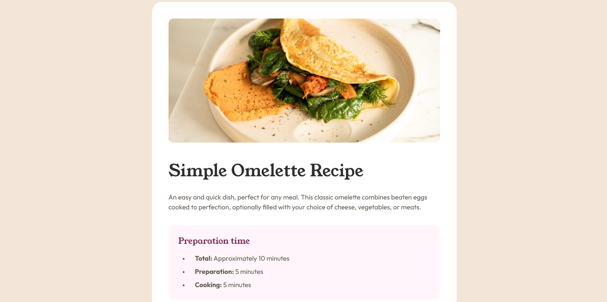
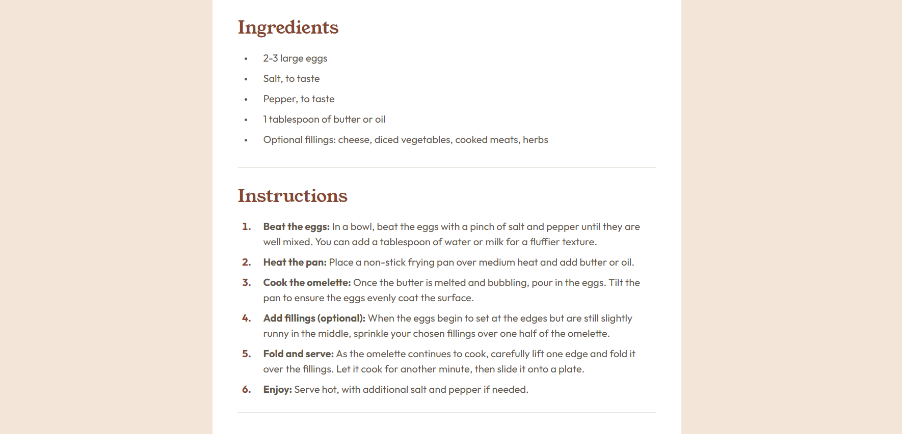

# Frontend Mentor - Recipe page solution

This is a solution to the [Recipe page challenge on Frontend Mentor](https://www.frontendmentor.io/challenges/recipe-page-KiTsR8QQKm). Frontend Mentor challenges help you improve your coding skills by building realistic projects.

## Table of contents

- [Overview](#overview)
  - [The challenge](#the-challenge)
  - [Screenshot](#screenshot)
  - [Links](#links)
- [My process](#my-process)
  - [Built with](#built-with)
  - [What I learned](#what-i-learned)
  - [Continued development](#continued-development)
  - [AI Collaboration](#ai-collaboration)
- [Author](#author)
- [Acknowledgments](#acknowledgments)

## Overview

### The challenge

Build a recipe page and get it looking as close to the design as possible. The layout changes between the designs:

- **Mobile:** a full-width page where the image touches the screen edges.
- **Tablet and desktop:** a floating white card on a stone background, with the image inside the card's padding and rounded corners.

### Screenshot

<p align="center">
  
</p>
<p align="center">
  
</p>
<p align="center">
  
</p>
### Links

- GitHub repository: [YOUR-REPO-NAME](https://github.com/hossamelgendy101/Recipe-page)
- Live site: [YOUR-LIVE-SITE](https://recipepage-eta.vercel.app/)

## My process

### Built with

- Semantic HTML5 markup (`article`, `header`, `section`, `ul`, `ol`, `table`)
- CSS custom properties
- Flexbox
- Mobile-first workflow with `min-width` media queries
- Google Fonts (Young Serif and Outfit)

### What I learned

- **Semantic structure:** I wrapped the recipe in an `article` and split it into `section` elements, each labelled by its heading with `aria-labelledby`. I used `ul` for preparation times and ingredients (order doesn't matter) and `ol` for the instructions (order matters). I also learned that heading levels describe the page structure and not the visual size, so the size comes from CSS.
- **Moving padding between layouts:** On mobile the image touches the screen edges, and on larger screens it sits inside the card's padding. To handle this without changing the HTML, I kept the image outside the content wrapper. On mobile the padding belongs to `.recipe__content`, and in the media query it moves to `.recipe`.
- **Styling list markers:** I used `::marker` to change the size and color of bullets and the weight of the numbers in the ordered list, instead of building custom bullets.
- **Data table:** I used `th scope="row"` for the row names and `td` for the values. I used `border-collapse: collapse` to merge the borders, put the dividing lines on the rows, and removed the last line with `:last-child`. I also learned why a table inside a flex column doesn't stretch by default, and fixed it with `width: 100%`.
- **Spacing and fonts:** I used `gap` with Flexbox instead of margins, and used `rem` for font sizes. Young Serif only has one weight (400), so I avoided bold on it to prevent a faux bold.

```css
.recipe__nutrition-table {
  width: 100%;
  border-collapse: collapse;
}

.recipe__nutrition-table tr:last-child {
  border-bottom: none;
}
```

### Continued development

- Choose breakpoints from where the design actually changes, based on the Figma frames, and not from device sizes.
- Reduce repeated CSS by sharing classes between sections that look alike, such as the headings and lists.
- Practice more with Grid on layouts that change between mobile and desktop.
- Add JavaScript interactions in the next projects.

### AI Collaboration

During this project, I collaborated with an AI assistant (**Claude**) to enhance my workflow and problem-solving process.

- **Tools used:** Claude, as a technical consultant and reviewer.
- **How I used it:** For reviewing my HTML structure, explaining why certain CSS approaches work (such as `::marker`, `border-collapse` and mobile-first media queries), and checking my responsive behavior.
- **What worked well:** The reviews pointed out mistakes I wouldn't have noticed, like using `id` selectors for styling and a breakpoint that matched the mobile size.
- **What I did myself:** I wrote the HTML and CSS by hand, read the values from Figma, and fixed the issues that came up in review.

## Author

- GitHub - [@hossamelgendy101](https://github.com/hossamelgendy101)
- Frontend Mentor - [@hossamnabil](https://www.frontendmentor.io/profile/hossamnabil)
- Twitter - [@hossamelgendy](https://www.twitter.com/hossamelgendy)

## Acknowledgments

- Thanks to **Frontend Mentor** for this challenge.
- Thanks to the developer community and AI assistant tools for guidance and feedback.
